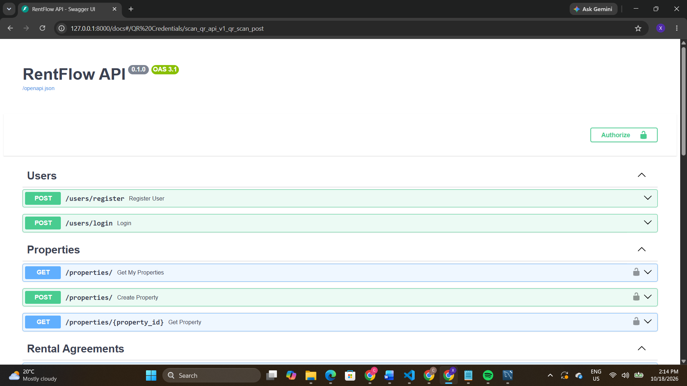
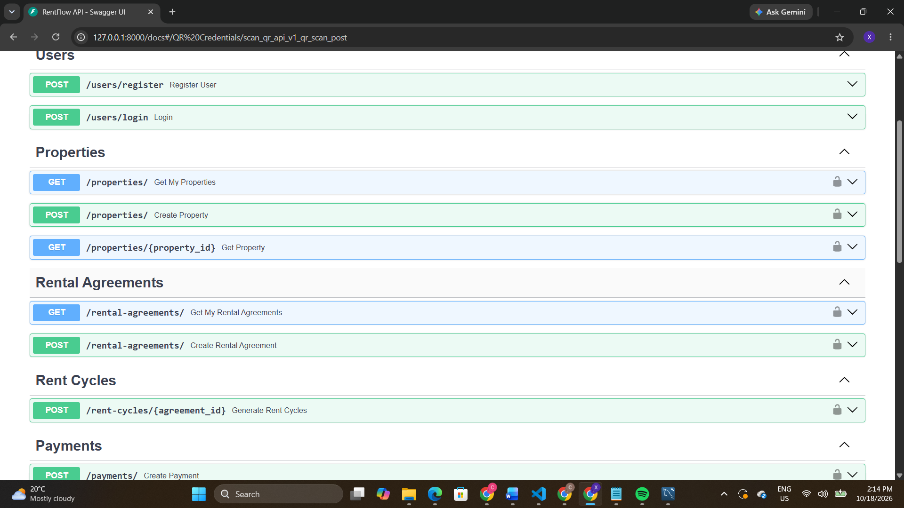

# 🏠 RentFlow

**A rental management and payment-tracking API for small-scale landlords and tenants**

  

> **Work in progress:** RentFlow currently consists of a backend API. No frontend has been developed, and payments are recorded in the database rather than processed through a live payment provider.

## Overview

RentFlow is a personal software development project exploring how digital tools could simplify rental administration and reduce dependence on cash-based rent collection, especially for small-scale landlords and tenants in South African township communities.

The backend manages users, rental properties, rental agreements, monthly rent cycles, and recorded payments. The long-term goal is a practical platform where landlords can monitor rent collection and tenants can view what they owe and request flexible payment arrangements.

## The problem

Cash payments and informal record-keeping can make it difficult to verify rent payments, track outstanding balances, and resolve disputes. RentFlow aims to create a clearer record of agreements and transactions while supporting landlord-controlled payment flexibility.

## Current functionality

- **Authentication:** User registration and login using JWTs, with landlord and tenant roles.
- **Property management:** Authenticated landlords can register properties with a location and monthly rental amount.
- **Rental agreements:** Store the landlord, tenant, property, rent amount, due day, and agreement dates.
- **Monthly rent cycles:** Generate rent periods and due dates, with paid and outstanding balances.
- **Payment recording:** Record tenant payments against their own rent cycles; reject invalid amounts and overpayments; update balances and `Pending`, `Partial`, or `Paid` status.
- **Partial-payment amount validation:** Existing payment logic includes a 30% minimum partial-payment rule, with an exception for settling a smaller final balance.

**Important:** The existing payment endpoint does **not yet enforce landlord approval before a partial payment**. That approval workflow is a planned feature, not a completed one. Recorded payment status is currently simulated; it does not confirm real funds have moved.

## API screenshots

These screenshots show the **current backend Swagger UI**, not a frontend application.

### FastAPI documentation



### Available endpoints



> Screenshots were captured from a local development server. The project does not yet have a frontend. A successful payment response screenshot can be added later after verifying that it contains no sensitive data.

## Tech stack

| Layer | Technology |
| --- | --- |
| Language | Python |
| API framework | FastAPI |
| ORM | SQLAlchemy |
| Database | SQLite |
| Request/response validation | Pydantic |
| Authentication | JWT / OAuth2 password flow |
| Interactive API documentation | Swagger UI (OpenAPI) |

## Key API operations

| Method | Route | Purpose |
| --- | --- | --- |
| `POST` | `/users/register` | Register a user |
| `POST` | `/users/login` | Authenticate and receive a JWT |
| `GET` | `/properties/` | List the authenticated user's properties |
| `POST` | `/properties/` | Create a property |
| `GET` | `/properties/{property_id}` | Retrieve a property |
| `GET` | `/rental-agreements/` | List the authenticated user's rental agreements |
| `POST` | `/rental-agreements/` | Create a rental agreement |
| `POST` | `/rent-cycles/{agreement_id}` | Generate rent cycles |
| `POST` | `/payments/` | Record a payment |

These routes are visible in the current Swagger UI. The screenshots document the API surface; they do not independently demonstrate that every route has been fully tested.

## Example: recording a payment

A tenant with access to a rent cycle can submit a request such as:

```http
POST /payments/
Authorization: Bearer <access-token>
Content-Type: application/json
```

```json
{
  "rent_cycle_id": 4,
  "amount": 360,
  "payment_method": "Open Payments"
}
```

The API records the payment and returns its details alongside the rent cycle's updated `amount_paid` and `outstanding_balance` values. **`Open Payments` is currently a label in the recorded transaction, not a completed external payment integration.**

## Local development

These commands assume the repository has a `backend/` directory containing the `app` Python package.

```bash
# Clone your repository, then enter the backend folder
cd rentflow/backend

# Create a virtual environment
python -m venv .venv

# Activate it on Windows PowerShell
.\.venv\Scripts\Activate.ps1

# Install the project's dependencies
pip install fastapi uvicorn sqlalchemy pydantic python-jose passlib bcrypt python-multipart

# Run the development server
python -m uvicorn app.main:app --reload
```

Visit **http://127.0.0.1:8000/docs** to explore the API.

**Configuration note:** The application may require local database and JWT configuration before startup. Check the project's configuration files. A pinned `requirements.txt`, `.env.example`, and reproducible database migration/setup process are still recommended before treating these instructions as a fully verified fresh-clone setup.

## Intended partial-payment workflow

The planned business rule is **landlord approval first**:

1. A tenant submits a partial-payment request for a rent cycle.
2. The landlord reviews and approves or rejects the request.
3. Only an approved request permits partial payments, subject to the applicable amount rules.
4. The system records approved payments and updates the remaining balance.

The approval and rejection endpoints, request state, and enforcement in `POST /payments/` still need to be implemented and tested.

## Roadmap

- [x] User registration, login, and roles
- [x] Property and rental agreement creation
- [x] Rent-cycle generation
- [x] Payment recording and balance updates
- [x] Basic partial-payment amount validation
- [ ] Tenant partial-payment request endpoint
- [ ] Landlord approval/rejection and authorization enforcement
- [ ] Payment and rent-cycle history endpoints
- [ ] Agreement lifecycle and extension-request workflows
- [ ] Overdue-rent detection and reminders
- [ ] Automated tests and database migrations
- [ ] Landlord and tenant frontend interfaces
- [ ] Secure, verified payment-provider integration
- [ ] Deployment

## Project status

**RentFlow is an ongoing personal portfolio project, not a production-ready financial service.** The current focus is the backend API and its rental business rules. The frontend, live payment processing, and additional safeguards remain future work.

## Developer

**Constance Xoliwe Maluleke**  
BSc Computer Science, University of the Western Cape  
[GitHub: @Xoliwe](https://github.com/Xoliwe)
